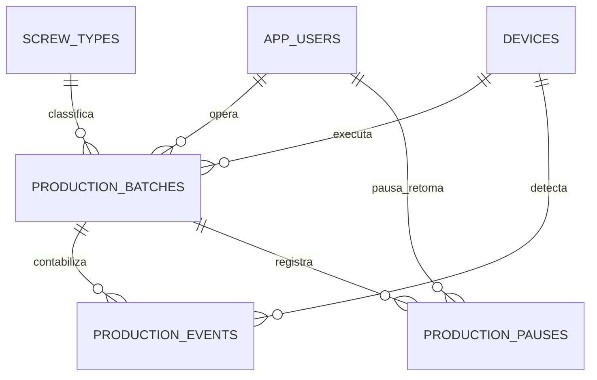

# Modelo, regras e decisões

## 1. Relacionamentos



| Tabela | Chave | Dados e relações |
|---|---|---|
| app_users | BIGINT identity | Nome, e-mail único normalizado, hash de senha, hash Analytics opcional, perfil enum, ativo |
| screw_types | BIGINT identity | Nome, descrição, URL da foto, especificações textuais, ativo |
| devices | VARCHAR(64) | Identificador estável, nome, SHA-256 de API Key aleatória, ativo |
| production_batches | BIGINT identity | Operação única, meta e contador BIGINT, status, tipo, operador, dispositivo, instantes e versão |
| production_events | UUID global BINARY(16) | Lote, dispositivo, detecção e recebimento DATETIME(6) UTC, posição no contador |
| production_pauses | BIGINT identity | Lote, operador da pausa, operador da retomada, horários |

Role é enum (OPERADOR, ANALISTA, ADMIN); não precisa de uma tabela de associação para um único perfil por usuário. Senhas/chaves nunca aparecem nos DTOs de consulta. Exclusão lógica mantém referências ao usuário, dispositivo e tipo original. A edição de nomes de cadastros aparece nas consultas históricas; se houver exigência futura de histórico imutável de nomes, adicionar snapshots/versionamento desses cadastros.

## 2. Constraints e índices

A definição exata está em `src/main/resources/db/migration/V1__initial_schema.sql`. Há checks para meta positiva, contador não negativo, enums válidos, término posterior ao início e status coerente. FKs garantem referências existentes. Índices por detecção, lote/recebimento, criação e término sustentam históricos e agregações.

No MySQL 8.0, colunas geradas open_device_id e open_batch_id, com índices UNIQUE, garantem um lote aberto por dispositivo e uma pausa aberta por lote. Estados encerrados/retomados geram NULL, permitindo vários históricos. Todas as tabelas usam InnoDB e FKs explícitas. A PK UUID garante idempotência global; um UUID reutilizado com payload diferente é conflito. Também se exige uma posição única de contagem em cada lote.

## 3. Máquina de estados

```text
CONFIGURADO -> EM_EXECUCAO -> PAUSADO -> EM_EXECUCAO
                   |            |
                   +-> FINALIZADO <-+
```

Somente operador responsável ou administrador altera o estado. Analista consulta. Não se inicia um lote duas vezes; não se finaliza um lote que nunca iniciou. Pausar registra ator e horário; retomar fecha a pausa. Encerrar um lote pausado conserva a pausa sem data de retomada porque não ocorreu retomada.

## 4. Concorrência

Uma transação bloqueia primeiro a linha do dispositivo e depois a linha do lote (`PESSIMISTIC_WRITE`, MySQL/InnoDB `FOR UPDATE`). Todos os caminhos de mutação adotam essa ordem. Isso serializa eventos e transições da mesma máquina e permite processamento independente entre máquinas. `@Version` é uma proteção adicional contra alterações que venham a contornar esse fluxo.

O lote é carregado após o bloqueio do dispositivo; em transições usa-se uma projeção do identificador do dispositivo antes disso, evitando entidades antigas no persistence context. Verificação de duplicidade, estado, horário, INSERT do evento e alteração do contador são atômicos. Uma constraint ou exceção provoca rollback de ambos. Em timeout/deadlock, o dispositivo deve repetir o payload original.

Uma retransmissão aceita é reconhecida mesmo depois de pausa/finalização. Isso não aceita uma nova peça; apenas confirma um evento já gravado. `currentCount` representa o contador atual do lote, não necessariamente a posição original do evento. `countAfter` no histórico preserva essa posição.

## 5. Horário e backlog

Um ESP32 autenticado declara o instante de detecção. É aceito atraso desde o início do lote, incluindo períodos sem rede, mas não timestamps anteriores ao início, acima de 30 segundos no futuro ou durante pausas. A API normaliza a precisão para microssegundos, igual à precisão DATETIME(6) do MySQL, para que retransmissões com nanossegundos não pareçam payloads diferentes.

O servidor não tem como comprovar que um sensor físico detectou uma peça naquele instante; relógio sincronizado, UUID persistido e dispositivo confiável fazem parte do contrato. Antes de finalizar, pare a alimentação, drene o sensor/fila e confirme os ACKs. Não se promete contagem de backlog após finalização, pois isso contradiz a imutabilidade solicitada para lotes encerrados.

## 6. Estratégia de atualização

Para o protótipo, polling HTTP a cada segundo é suficiente e funciona entre várias instâncias da API sem estado local de WebSocket. O front-end obtém meta, contador, percentual, tipo e status num único DTO. O histórico usa paginação. SSE/WebSocket pode ser acrescentado posteriormente com publicação somente após commit e um broker quando houver várias instâncias.

## 7. Erros

Formato: `timestamp`, `status`, `code`, `message`, `path`, `details`. Bean Validation gera detalhes por campo. 400: dados/formato inválidos; 401: credencial inválida; 403: perfil ou associação inadequada; 404: recurso inexistente; 409: estado, UUID ou constraint em conflito; 500: erro interno sem stack trace para o cliente.

Um evento duplicado idêntico é sucesso 200 com `duplicate=true`, para que o ESP32 possa retirar o item da fila. Reutilização conflitante do UUID é 409. Não há uma resposta de erro para retransmissão legítima.

## 8. Especificidades MySQL 8.0

AUTO_INCREMENT substitui identity; BINARY(16) armazena UUIDs e o DTO continua exibindo UUID textual. Collation utf8mb4_bin preserva distinção de maiúsculas/minúsculas dos identificadores. O mapeamento Hibernate de UUID é explicitamente binário e de Instant usa TIMESTAMP JDBC, persistido em DATETIME(6) UTC.

O Analytics agrega DATE_FORMAT(detected_at, '%Y-%m-%d %H:00:00') no banco e converte os buckets UTC em Java para America/Sao_Paulo, incluindo regras históricas de horário de verão. Horas locais repetidas são somadas. A configuração de fuso usada pelo projeto tem deslocamentos em horas inteiras; para adicionar regiões com deslocamentos de meia hora, rever o agrupamento UTC antes da conversão.

Referências: [colunas geradas MySQL](https://dev.mysql.com/doc/refman/8.0/en/create-table-generated-columns.html), [horários no Connector/J](https://dev.mysql.com/doc/connector-j/en/connector-j-connp-props-datetime-types-processing.html), [módulo MySQL do Flyway](https://documentation.red-gate.com/fd/mysql-277579322.html).
